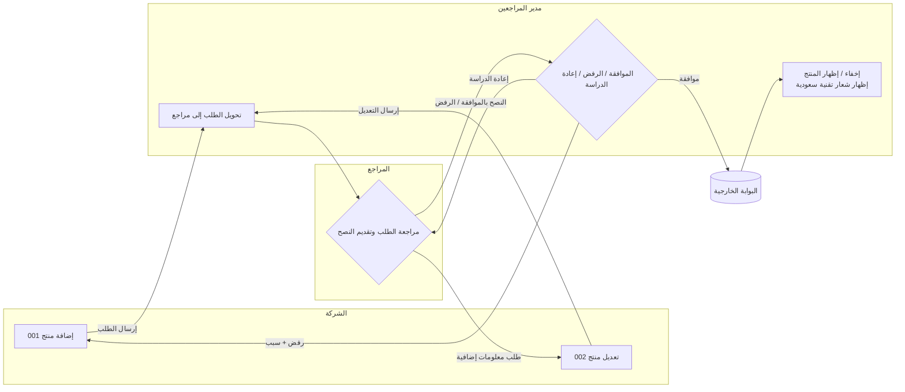

# BRD Generator: Instructions for the Building AI

Derived from two sample BRDs:
- **Doc A**: Product Management service (إدارة المنتجات), v0.5 — a CST platform ("متصل" / "منصة تك").
- **Doc B**: Electronic Violations System, Review Committee Secretariat (نظام المخالفات الالكتروني – امانة لجنة النظر), v0.3.

Both are Arabic government-style "Business Requirements / Requirements Analysis" documents with an identical skeleton. The app should generate documents in this structure.

---

## 1. Product rules for the app

1. **Language**: Arabic primary, RTL layout. Field-level labels in Doc A are bilingual (Arabic + English) — support both. Dropdown values may be bilingual.
2. **Output**: DOCX (matches the originals), with optional PDF. Keep tables, section numbering, and headings consistent.
3. **Input**: the user describes a business process (free text or guided form); the app produces the BRD *and* a process-flow diagram.
4. **Tone**: formal Modern Standard Arabic, imperative/declarative business-rule phrasing ("يجب أن يقوم النظام بـ…", "يتم عرض…", "عند الضغط على… يتم…").
5. Never invent integrations, percentages, limits, or roles. If missing, insert a `[بحاجة إلى توضيح]` placeholder and list it in an "Open questions" section.

## 2. Mandatory BRD structure (in this order)

1. **Title page**: document title, owning department in parentheses.
2. **Revision history table**: Version | Analyzed by | Delivery date | Status | Notes (+ a "Description" row).
3. **Review list** and **Approval list** tables: Name | Date | Signature | Notes.
4. **مقدمة عامة** (General introduction):
   - تعريف حاجة العمل (business need)
   - الأهداف (objectives)
   - المصطلحات والتعاريف (glossary table: term | definition). Include every role and system named later.
5. **مخطط سير العمل** (workflow diagram) — see section 4.
6. **One block per business procedure** (إجراء العمل) — see section 3.
7. **Roles & permissions table** (جدول الأدوار والصلاحيات): Role | Permission. (Doc B)
8. **General business rules** (قواعد العمل العامة) that apply across all procedures. (Doc B)
9. **Notes and expectations** (الملاحظات والتوقعات): data migration, unlimited returns, data sources. (Doc A)
10. **Appendices** (الملحقات): classification lists, sample outputs (e.g. decision template), integration files, notification texts.

## 3. Procedure block template (repeat per procedure)

```
إجراء العمل (<name>)
وصف الإجراء: <1–2 sentences: when it starts, who does what>
تفاصيل أنشطة الإجراء
  رمز النشاط: <number> | عنوان النشاط: (<name>)
  الدور:            <actor/role>
  المدخلات:         <what it receives>
  المخرجات:         <possible outcomes, one per action button>
  الوصف:            <one sentence>
  نقاط التكامل:     <external systems, or empty>
  متطلبات التقارير: <reporting needs, or empty>
  ملاحظات:          <optional>
  تفاصيل قواعد العمل (numbered table)
  جدول الحقول: # | عنوان الحقل | نوع الحقل | إجبارية الحقل | ملاحظات | الرسائل
  جدول الرسائل: الرمز | النص | النوع | القناة
```

**Business-rule conventions seen in both documents** (apply them when generating rules):
- Rule 1 of every screen: what the actor sees (list page, then record detail, with attachments viewable/printable/downloadable).
- One rule per action button, stating the **next state, next actor, and notification sent**.
- **Conditional fields**: say "يظهر الحقل عند اختيار …" (e.g. a field shown only if the answer is "Yes").
- **Mandatory notes**: reject/return actions force a comment explaining why.
- **Confirmation dialog** before any irreversible action, with Confirm / Back (تأكيد / تراجع).
- **Save button** shows "تم الحفظ بنجاح".
- **Timeouts/deadlines** are in working days (أيام عمل); say what happens when the deadline expires (auto-return or auto-route to the next inbox).
- **Return loops**: state explicitly whether returns are unlimited.
- **Print views**: internal view (with internal workflow) vs. external/violator view (without it, with certain fields hidden).
- **Distribution inboxes** (صندوق توزيع): items land in an inbox, a distributor assigns them to a team member.
- **Message codes**: MSG01, MSG02… are local to each procedure; each has text, type (message / confirmation / error), channel (popup / in-app alert / SMS / email).

**Field-table conventions** (Doc A):
- Field types: text field, text area, number, date, dropdown list, multi-select dropdown, radio button, checkbox, file, list table, button.
- Always give max length and allowed characters ("50 حرف عربي أو رقم فقط", "400 حرف").
- File rules: allowed type, max size, min/max attachment count (e.g. PDF, 5 MB, 1–3 files).
- Computed read-only fields: describe the formula and display format.
- Helper/tooltip text for non-obvious fields, in Arabic and English.
- Mandatory declaration checkboxes (إقرارات) at the end of submission forms.

## 4. Workflow ("سير الإجراء") — how to build it

Both documents have a "مخطط سير العمل" section holding a **diagram**, which didn't survive text extraction (they're images). Build it as follows.

**Recommended approach**: have the AI emit the workflow as **Mermaid flowchart code**, render it to SVG/PNG, and embed it in the DOCX. The code is also kept in the app as editable source, so the user can tweak the flow and regenerate. Use **swimlanes** (one per role) because each activity has a single responsible role.

Generation pipeline:
1. Extract the **actors** (roles) and **activities** (numbered, one per role action).
2. For each activity, the **outputs** (المخرجات) become the labelled outgoing edges (e.g. "ارجاع", "ارسال الاشعار", "طلب استفسار").
3. Deadlines/timeouts become edges labelled with the condition ("انتهاء المهلة").
4. External systems (ERP, external portal, payment platform) become distinct node shapes.
5. Validate: every activity has an incoming and outgoing edge, no dead ends other than "closed", every output in the table appears as an edge.

Example (from Doc A, product request lifecycle):



Provide two views: (a) high-level end-to-end flow, (b) one detailed diagram per procedure. The user should be able to edit nodes in the UI (form-based editor or Mermaid text) and see the diagram update live.

## 5. Domain knowledge to preload (common to both docs)

- **Organization**: Saudi government regulator (Communications, Space & Technology Commission, "الهيئة"). Platforms: متصل, منصة تك, ايفاء (payment), ERP, external portal, Power BI for reporting.
- **Recurring actors**: submitter/company user, reviewer, reviewer manager, legal studier, committee chair, committee secretary, committee members, violator, reporter, distributors of inboxes.
- **Recurring patterns**: submit → review → advise → approve/reject/return loop; inbox-and-distributor assignment; request-for-information to another sector with a deadline; notification on every state change (in-app + SMS); audit of "workflow history" visible to internal users only.
- **Reporting**: standard sentence "سيتم الحصول على التقارير من خلال أداة ذكاء الأعمال (MS Power BI)".
- **Integration points**: always name the system, direction, and the data sent (e.g. approved product → external portal with listed fields).
- **Document dependency**: later docs may refer to activities in earlier docs ("نشاط رقم 11 في وثيقة تحليل إدارة الالتزام"). Support cross-document references.
- **Status vocabulary**: new, advised approve, advised reject, needs more information, approved, rejected, hidden, paid, closed.
- **Formatting rules**: Arabic-Indic numerals in formal outputs where required; omit empty fields in generated letters/decisions; consistent punctuation templates.

## 6. Suggested app workflow (the app itself)

1. **Intake**: project metadata (title, department, author, version).
2. **Actors & glossary**: list roles, systems and terms.
3. **Procedures**: for each, add activities via the template in section 3 (AI proposes, user edits).
4. **Flow review**: auto-generated diagram; user adjusts.
5. **Fields & messages**: AI drafts field tables and MSG tables from the rules.
6. **Consistency check**: unreferenced roles/messages, missing deadlines, outputs without a next step, fields mentioned in rules but not in the table.
7. **Export**: DOCX/PDF with revision-history row auto-added.

## 7. Style requirements for AI-generated content

- Short, numbered, testable rules: one behavior per rule.
- Every action button states: result, new status, next actor, notification.
- Use "يجب أن يدعم النظام" for non-negotiable requirements and "يتم" for described behavior.
- Do not copy real names, sample entities, or numbers from these two source documents into new BRDs.

---

# Part 2: How CST systems are built (inferred from the two sample BRDs)

> These are patterns observed in the two documents, not official CST standards. The AI should treat them as defaults and let the user override them. Where the user's input conflicts with a default, the user's input wins.

## 8. CST system architecture patterns

### 8.1 Platform landscape
| Element | What the documents show |
|---|---|
| Internal platform (المنصة الداخلية) | Staff-facing portal with a service button per service (e.g. "إدارة المنتجات"); lists of requests, request detail, action buttons. |
| External/customer platform (متصل / منصة تك) | Company-facing portal. The user's eligibility is checked on every entry by querying registration/licence status. Error `MSG01` when not eligible. |
| External public portal (البوابة الخارجية) | Receives approved records through an integration, with an explicit field list. Supports hide/show of a record and badges (e.g. "تقنية سعودية"). |
| ERP (finance) | Receives financial data (fine amount, violator) to issue invoices. |
| Payment platform (ايفاء) | Invoice and violation reflected on it after the invoice is issued. |
| Reporting | MS Power BI; reports are not built in the app. The BRD says so in one line. |
| Notifications | In-app alert plus SMS for staff and parties; popup messages for on-screen feedback. |
| Legacy system | "كما هو في النظام الحالي": new BRDs often describe *replicating* existing behavior. The AI should support an "as-is" marker per rule. |

### 8.2 Domain model every service shares
- **Request/Case** (طلب / مخالفة): has a unique number, status, current owner (user or inbox), attachments, comments, and an immutable **workflow history** (سير الإجراء).
- **Actor/Role**: roles are *permissions* that can be held by several people ("هي صلاحية وقد يكون فيها اكثر من شخص"). BRDs define a permission per activity in the roles table.
- **Inbox** (صندوق): a queue owned by a role; a *distributor* role assigns items to members.
- **Action**: each activity ends with 1..n actions (buttons). Each action = {label, target actor/inbox, new status, required fields, notification, confirmation}.
- **Attachment**: type/size/count rules, visibility flag (shown to external party or not).
- **Message/Notification**: code, text with `<placeholders>`, type, channel.
- **Lookup lists**: classifications (with sub-classifications), sectors, departments, users by department, countries, return reasons, ready-made comment templates ("نماذج جاهزة").

### 8.3 Standard screens per service
1. **Service entry** → eligibility check → list screen.
2. **List screen**: columns such as service type, request number, info, party, dates, priority, received date, expected delivery date, remaining time.
3. **Detail screen**: all data, internal workflow, attachments (view / print / download), plus the actor's action panel.
4. **Action panel**: choose an action, the matching fields appear, mandatory comment, optional attachment, Save and Confirm.
5. **Print views**: internal vs. external perspective.
6. **Download-all**: one ZIP of every attachment on the case.

### 8.4 Cross-cutting behaviors the AI must always consider
- **Return loops** (returns to the previous actor, with return reason = formal / substantive / both).
- **Consultation loops** (ask another sector/department/user; the case comes back to the requester on reply *or on timeout*).
- **Timeouts**: every waiting state has a deadline and a defined expiry behavior. Ask for it if missing.
- **Visibility matrix**: who may see which fields, attachments and workflow entries. External parties see a reduced view.
- **Sequential multi-approver circulation** (تداول): approver picks the next approver from the remaining list; any edit or return cancels earlier approvals; the secretary gives the final approval.
- **Document generation**: fixed templates (decision draft, minutes) filled from case data; skip empty fields; fixed punctuation/number format; export PDF/Word.
- **Hijri + Gregorian dates**: Hijri calendar inputs for searches, both calendars on generated documents.
- **Unique numbering**: sequence-per-year format such as `1-2021`.
- **Auto-routing on expiry**: e.g. response deadline passes → case moves to the next team's inbox.
- **Notification on every handoff**: define text for each in a separate notifications document (referenced in an appendix).

### 8.5 Decision/scoring logic in BRDs
When a rule involves a calculation (e.g. local contribution score, ownership %, classification thresholds), write it as **inputs → weights → formula → thresholds → resulting category**, with a table. Example from Doc A: weighted yes/no answers sum to a "local contribution" percentage; with ownership %, a 2×2 matrix (thresholds 40% and 50%) yields the product category. Do not hardcode these values in new BRDs.

## 9. Workflow ("سير الإجراء") — implementation spec

Goal: the app produces the workflow from the *same data* that produces the BRD tables, so the diagram and the text can never disagree.

### 9.1 Single source of truth: a workflow JSON model
```json
{
  "actors": [{ "id": "studier1", "name": "الدارس القانوني الأول", "type": "role" },
             { "id": "violator", "name": "المخالف", "type": "external" },
             { "id": "erp", "name": "ERP المالية", "type": "system" }],
  "inboxes": [{ "id": "inbox_team2", "name": "صندوق توزيع فريق اللجنة الثانية", "owner": "distributor2" }],
  "activities": [{
    "code": 1, "title": "دراسة لائحة الادعاء واعداد الاشعار", "actor": "studier1",
    "actions": [
      { "label": "ارسال الاشعار",   "to": "chair",     "status": "بانتظار اعتماد الاشعار" },
      { "label": "ارجاع لوجود ملاحظات", "to": "ext:violations-dept", "status": "معاد" },
      { "label": "طلب استفسار من قطاع", "to": "ext:sector", "returns_to": "self", "timeout_days": null }
    ],
    "timeouts": [{ "after": "مهلة الرد", "to": "inbox_team2", "auto": true }]
  }],
  "start": { "to": "inbox_team1", "trigger": "اعتماد لائحة الادعاء" },
  "end":   [{ "id": "closed", "label": "إغلاق المخالفة" }]
}
```
Rules for the model:
- Every `action.to` must resolve to an actor, inbox, system, or end node.
- `returns_to: "self"` creates a loop node ("consultation") instead of a normal edge.
- Every action implies one row in the activity's business-rules table and one output in "المخرجات". Generate those from the model, not separately.

### 9.2 Rendering
1. **JSON → Mermaid** (deterministic code, not LLM-written): swimlane subgraph per actor, rounded node per activity, diamond when an activity has 2+ actions, cylinder for systems/inboxes, dashed edges for timeouts, labelled edges for actions.
2. Render via Mermaid CLI/`mermaid.js` to SVG, then PNG for DOCX embedding. Use an Arabic font and `direction RL` options so labels aren't reversed.
3. Provide **two diagram levels**: overview (one node per activity), and per-procedure detail (actions, fields, notifications).
4. In the UI: show the diagram next to the activity list; clicking a node opens that activity; editing an action updates the diagram live.
5. Export both the PNG (for the DOCX) and the Mermaid source.

### 9.3 Validation checklist (run before export)
- Every non-terminal activity has ≥1 outgoing action; every activity except the first has ≥1 incoming edge.
- Every waiting state has a timeout or an explicit "no deadline".
- Every action that changes party/status has a notification (or an explicit "none").
- Every return edge goes to a node that has an action able to resume.
- External parties never see internal-only nodes in their (derived) workflow view: generate that second view by filtering `visibility`.
- Terminal states are named (approved, rejected, closed, paid).

### 9.4 Worked example: violations lifecycle (from Doc B)
```mermaid
flowchart TD
  S(["اعتماد لائحة الادعاء\nمن إدارة المخالفات"]) --> I1[("صندوق توزيع اللجنة الأولى")]
  I1 --> A1["1 دراسة لائحة الادعاء واعداد الاشعار\nالدارس القانوني الأول"]
  A1 -->|ارجاع لوجود ملاحظات| EXT0["إدارة المخالفات"]
  EXT0 -->|إعادة إرسال بعد الاعتماد| I1
  A1 -->|طلب استفسار من قطاع| Q1(("قطاع / إدارة"))
  Q1 -->|رد أو انتهاء المهلة| A1
  A1 -->|ارسال الاشعار| A2{"2 اعتماد الاشعار\nرئيس اللجنة"}
  A2 -->|ارجاع| A1
  A2 -->|اعتماد| A3["3 رد المخالف على الاشعار\nالمخالف"]
  A3 -->|طلب مهلة| A3b{"رئيس اللجنة:\nموافقة / رفض"}
  A3b -->|موافقة: أيام عمل جديدة| A3
  A3b -->|رفض: المتبقي فقط| A3
  A3 -->|رد| I2[("صندوق توزيع اللجنة الثانية")]
  A3 -.->|انتهاء المهلة| I2
  I2 --> A4["4 دراسة الرد وإعداد مسودة القرار\nالدارس القانوني الثاني"]
  A4 -->|إعادة للدارس الأول| A1
  A4 -->|طلب افادة من المبلغ| A5["5 رد المبلغ"]
  A5 --> A4
  A4 -->|ارسال القرار| A6{"6 مراجعة القرار الأولية\nالمراجع القانوني"}
  A6 -->|إعادة| A4
  A6 -->|للمراجع الثاني| A7{"7 مراجعة القرار الثانية\nأمين السر"}
  A6 -->|مباشرة| I3
  A7 -->|إعادة| A6
  A7 -->|ارسال القرار| I3[("8 صندوق القرارات الجاهزة")]
  I3 -->|توزيع على عضو| A9{"9 تداول القرار\nأعضاء اللجنة بالتتابع"}
  A9 -->|إعادة (أي جهة سابقة)| A4
  A9 -->|اعتماد الأعضاء + أمين السر| A10{"10 اعتماد تبليغ المخالف\nرئيس اللجنة"}
  A10 -->|إعادة| A7
  A10 -->|عدم إدانة| E1(["إشعار وإغلاق"])
  A10 -->|إدانة بغرامة| A13[/"13 إصدار فاتورة\nERP + ايفاء"/]
  A13 -->|سداد خلال 30 ثم 15 يوم عمل| E2(["تم السداد وإغلاق"])
  A13 -.->|عدم السداد| E3(["تسجيل في نظام القضايا وإغلاق"])
  A9 -.-> M["11-12 محضر الاجتماع\n(مسار منفصل: ليس ضمن سير المخالفة)"]
```
Note the minutes (11–12) are a **separate procedure** that never appears in the violation's workflow or attachments; keep it as a separate diagram when a procedure is flagged `"standalone": true`.

### 9.5 Prompting the LLM for the workflow
Ask the LLM only to **extract and fill the JSON model** from the user's description (in Arabic), then let code render. Prompt contract:
1. List actors, inboxes, systems → ask clarifying questions for any unnamed actor.
2. For each activity list actions and targets → flag missing return paths and timeouts.
3. Return JSON only, validated against the schema; on validation failure, return the errors to the LLM for one repair attempt.
4. Never write Mermaid by hand in the LLM output.

## 10. Extra rules for a "CST-aware" system prompt
- Default to formal Arabic and the templates above; mention the bilingual field-label convention for forms and Arabic-only for internal workflow screens.
- Ask for the **notifications** and **integration** details before finishing a procedure; empty rows are allowed, but never invented.
- Ask whether a rule is **new** or **"كما هو في النظام الحالي"** (as-is) and mark it.
- Reference other documents by activity number when a procedure reuses another document's fields.
- Keep rule text implementation-neutral (no technology, database or UI-framework statements) — the BRs describe *what* the system does.
- Always produce an **open-questions list** at the end of the BRD.
