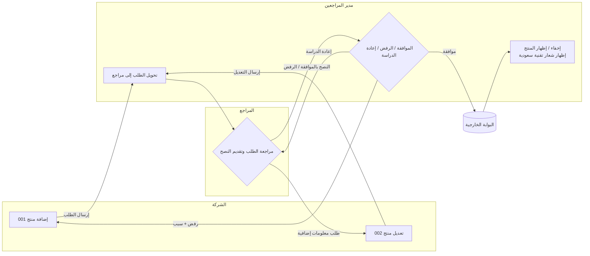

# BRD Generator: Instructions for the Building AI

Derived from two sample BRDs:
- **Doc A**: Product Management service (إدارة المنتجات), v0.5 — a CST platform ("متصل" / "منصة تك").
- **Doc B**: Electronic Violations System, Review Committee Secretariat (نظام المخالفات الالكتروني – امانة لجنة النظر), v0.3.

Both are Arabic government-style "Business Requirements / Requirements Analysis" documents with an identical skeleton. The app should generate documents in this structure.

---

## 1. Product rules for the app

1. **Language**: Arabic primary, RTL layout. Field-level labels in Doc A are bilingual (Arabic + English) — support both. Dropdown values may be bilingual.
2. **Output**: DOCX (matches the originals), with optional PDF. Keep tables, section numbering, and headings consistent.
3. **Input**: the user describes a business process (free text or guided form); the app produces the BRD *and* a process-flow diagram.
4. **Tone**: formal Modern Standard Arabic, imperative/declarative business-rule phrasing ("يجب أن يقوم النظام بـ…", "يتم عرض…", "عند الضغط على… يتم…").
5. Never invent integrations, percentages, limits, or roles. If missing, insert a `[بحاجة إلى توضيح]` placeholder and list it in an "Open questions" section.

## 2. Mandatory BRD structure (in this order)

1. **Title page**: document title, owning department in parentheses.
2. **Revision history table**: Version | Analyzed by | Delivery date | Status | Notes (+ a "Description" row).
3. **Review list** and **Approval list** tables: Name | Date | Signature | Notes.
4. **مقدمة عامة** (General introduction):
   - تعريف حاجة العمل (business need)
   - الأهداف (objectives)
   - المصطلحات والتعاريف (glossary table: term | definition). Include every role and system named later.
5. **مخطط سير العمل** (workflow diagram) — see section 4.
6. **One block per business procedure** (إجراء العمل) — see section 3.
7. **Roles & permissions table** (جدول الأدوار والصلاحيات): Role | Permission. (Doc B)
8. **General business rules** (قواعد العمل العامة) that apply across all procedures. (Doc B)
9. **Notes and expectations** (الملاحظات والتوقعات): data migration, unlimited returns, data sources. (Doc A)
10. **Appendices** (الملحقات): classification lists, sample outputs (e.g. decision template), integration files, notification texts.

## 3. Procedure block template (repeat per procedure)

```
إجراء العمل (<name>)
وصف الإجراء: <1–2 sentences: when it starts, who does what>
تفاصيل أنشطة الإجراء
  رمز النشاط: <number> | عنوان النشاط: (<name>)
  الدور:            <actor/role>
  المدخلات:         <what it receives>
  المخرجات:         <possible outcomes, one per action button>
  الوصف:            <one sentence>
  نقاط التكامل:     <external systems, or empty>
  متطلبات التقارير: <reporting needs, or empty>
  ملاحظات:          <optional>
  تفاصيل قواعد العمل (numbered table)
  جدول الحقول: # | عنوان الحقل | نوع الحقل | إجبارية الحقل | ملاحظات | الرسائل
  جدول الرسائل: الرمز | النص | النوع | القناة
```

**Business-rule conventions seen in both documents** (apply them when generating rules):
- Rule 1 of every screen: what the actor sees (list page, then record detail, with attachments viewable/printable/downloadable).
- One rule per action button, stating the **next state, next actor, and notification sent**.
- **Conditional fields**: say "يظهر الحقل عند اختيار …" (e.g. a field shown only if the answer is "Yes").
- **Mandatory notes**: reject/return actions force a comment explaining why.
- **Confirmation dialog** before any irreversible action, with Confirm / Back (تأكيد / تراجع).
- **Save button** shows "تم الحفظ بنجاح".
- **Timeouts/deadlines** are in working days (أيام عمل); say what happens when the deadline expires (auto-return or auto-route to the next inbox).
- **Return loops**: state explicitly whether returns are unlimited.
- **Print views**: internal view (with internal workflow) vs. external/violator view (without it, with certain fields hidden).
- **Distribution inboxes** (صندوق توزيع): items land in an inbox, a distributor assigns them to a team member.
- **Message codes**: MSG01, MSG02… are local to each procedure; each has text, type (message / confirmation / error), channel (popup / in-app alert / SMS / email).

**Field-table conventions** (Doc A):
- Field types: text field, text area, number, date, dropdown list, multi-select dropdown, radio button, checkbox, file, list table, button.
- Always give max length and allowed characters ("50 حرف عربي أو رقم فقط", "400 حرف").
- File rules: allowed type, max size, min/max attachment count (e.g. PDF, 5 MB, 1–3 files).
- Computed read-only fields: describe the formula and display format.
- Helper/tooltip text for non-obvious fields, in Arabic and English.
- Mandatory declaration checkboxes (إقرارات) at the end of submission forms.

## 4. Workflow ("سير الإجراء") — how to build it

Both documents have a "مخطط سير العمل" section holding a **diagram**, which didn't survive text extraction (they're images). Build it as follows.

**Recommended approach**: have the AI emit the workflow as **Mermaid flowchart code**, render it to SVG/PNG, and embed it in the DOCX. The code is also kept in the app as editable source, so the user can tweak the flow and regenerate. Use **swimlanes** (one per role) because each activity has a single responsible role.

Generation pipeline:
1. Extract the **actors** (roles) and **activities** (numbered, one per role action).
2. For each activity, the **outputs** (المخرجات) become the labelled outgoing edges (e.g. "ارجاع", "ارسال الاشعار", "طلب استفسار").
3. Deadlines/timeouts become edges labelled with the condition ("انتهاء المهلة").
4. External systems (ERP, external portal, payment platform) become distinct node shapes.
5. Validate: every activity has an incoming and outgoing edge, no dead ends other than "closed", every output in the table appears as an edge.

Example (from Doc A, product request lifecycle):



Provide two views: (a) high-level end-to-end flow, (b) one detailed diagram per procedure. The user should be able to edit nodes in the UI (form-based editor or Mermaid text) and see the diagram update live.

## 5. Domain knowledge to preload (common to both docs)

- **Organization**: Saudi government regulator (Communications, Space & Technology Commission, "الهيئة"). Platforms: متصل, منصة تك, ايفاء (payment), ERP, external portal, Power BI for reporting.
- **Recurring actors**: submitter/company user, reviewer, reviewer manager, legal studier, committee chair, committee secretary, committee members, violator, reporter, distributors of inboxes.
- **Recurring patterns**: submit → review → advise → approve/reject/return loop; inbox-and-distributor assignment; request-for-information to another sector with a deadline; notification on every state change (in-app + SMS); audit of "workflow history" visible to internal users only.
- **Reporting**: standard sentence "سيتم الحصول على التقارير من خلال أداة ذكاء الأعمال (MS Power BI)".
- **Integration points**: always name the system, direction, and the data sent (e.g. approved product → external portal with listed fields).
- **Document dependency**: later docs may refer to activities in earlier docs ("نشاط رقم 11 في وثيقة تحليل إدارة الالتزام"). Support cross-document references.
- **Status vocabulary**: new, advised approve, advised reject, needs more information, approved, rejected, hidden, paid, closed.
- **Formatting rules**: Arabic-Indic numerals in formal outputs where required; omit empty fields in generated letters/decisions; consistent punctuation templates.

## 6. Suggested app workflow (the app itself)

1. **Intake**: project metadata (title, department, author, version).
2. **Actors & glossary**: list roles, systems and terms.
3. **Procedures**: for each, add activities via the template in section 3 (AI proposes, user edits).
4. **Flow review**: auto-generated diagram; user adjusts.
5. **Fields & messages**: AI drafts field tables and MSG tables from the rules.
6. **Consistency check**: unreferenced roles/messages, missing deadlines, outputs without a next step, fields mentioned in rules but not in the table.
7. **Export**: DOCX/PDF with revision-history row auto-added.

## 7. Style requirements for AI-generated content

- Short, numbered, testable rules: one behavior per rule.
- Every action button states: result, new status, next actor, notification.
- Use "يجب أن يدعم النظام" for non-negotiable requirements and "يتم" for described behavior.
- Do not copy real names, sample entities, or numbers from these two source documents into new BRDs.
